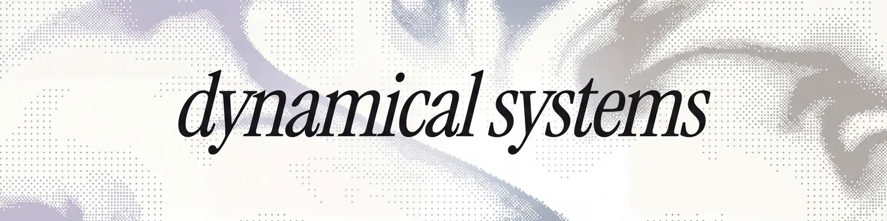

# magnet-benchmarks

Open experimental records and a standalone Python demagnetization model for heavy-rare-earth-free permanent magnets.

High-temperature electric motors typically add dysprosium or terbium to keep neodymium magnets from losing strength when hot. This repository pairs sintered magnet laboratory measurements with a lightweight physics model so researchers can study how grain structure, surface finishing, and alternative alloy chemistries behave under realistic motor operating conditions.

## What Is Included

- **Experimental data** in `data/` covering 15 isotropic sintered NdFeB specimens, 1 ball-milled powder feedstock, density measurements, room-temperature magnetic tests, microstructure notes, and a microscopy metadata catalog (SHA-256 checksums and detector settings; raw image pixels are archived separately). All numeric columns contain plain numbers or empty values so tables load directly in Python, and every child table joins cleanly on `specimen_id`.
- **Reference curve model** in `magnet_benchmarks/` providing a `numpy`-only model of how aligned heavy-rare-earth-free NdFeB magnets demagnetize across temperature, opposing fields, field angles, and thin-part surface grinding.
- **Automated tests** in `tests/` checking physical monotonicity, thermal return behavior, and curve contracts.

Experimental specimens (`#1` through `#9`, historical `Sample A` through `Sample E`, `DG11-3`, and the ball-milled powder aliquot) were produced and characterized in collaboration with Rensselaer Polytechnic Institute (`Dr. Jie Lian`, `Ziyi Wu`, and `Nick Fox`).

## Important Data Notes

- **Isotropic lab samples vs aligned motor magnets.** All sintered specimens currently in `data/` are isotropic NdFeB coupons (unaligned grains, up to `0.81 T` remanence at `~300 K`). The Python model simulates aligned motor-grade magnets (`1.3` to `1.45 T`), which require grain alignment during pressing or hot deformation.
- **Failed runs and unmeasured fields are explicit.** Specimen `#9` (sintered from ball-milled fine powder at `850 C`) oxidized and decomposed into alpha-Fe. High-density runs (`#8` reached `7.58 g/cm3`, `99.0%` theoretical density after `900 C` annealing) sit alongside it so models can be tested against real synthesis limits. Quantitative polished/EBSD grain sizes are not yet measured for `#1` through `#8` because fracture-SEM surfaces are excluded from stereology.
- **Upcoming elevated-temperature loops.** We are targeting December measurements on isotropic coupons `#7` and `#8` at `20`, `90`, and `105 C`, and will append those measured loops directly to `data/` as they arrive, with aligned elevated-temperature curves to follow.

## Benchmark Operating Regime and Open Questions

To evaluate thin heavy-rare-earth-free magnets under realistic wide-gap coreless motor duty rather than room-temperature ratings alone, we use an independent thin-segment benchmark sweep covering flat axial magnets (`1.5 to 3.0 mm` thick) at low permeance coefficients (`0.5 to 1.0`), corresponding to opposing axial fields around `-350 to -550 kA/m` (`-4.4 to -6.9 kOe`), corner field angles up to `15 to 30 degrees`, and added reverse field from winding current under `50 kA/m`. Baseline reference is heavy-rare-earth-free `N42` (`1.31 T`, `12.7 kOe` bulk at `20 C` in `virgin_n42_baseline`), evaluated at `90` and `105 C`, with next-generation screening at `120 C`.

Two open questions guide active work

1. **Hot stability in heavy-rare-earth-free NdFeB (`90 to 105 C`).** On `1.5 to 3.0 mm` thin magnets under `-350 to -550 kA/m` and `0 to 30 degree` field angles, how strongly do grain-size uniformity, grain-boundary isolation, and a `10 to 20 um` grinding-damaged surface layer shift the hot knee and permanent return loss? In the built-in presets on a `2.0 mm` slice, `virgin_n52_high_br` drops to a `105 C` axial knee (zero transverse field) of `278 kA/m`, whereas `virgin_n48h_gb_engineered` holds a `105 C` axial knee of `672 kA/m` (`10 um` skin) to `666 kA/m` (`20 um` skin). Under a `105 C` excursion at `-450 kA/m` axial and `50 kA/m` transverse, `virgin_n52_high_br` suffers severe permanent loss, while doubling the damaged layer on `virgin_n48h_gb_engineered` from `10` to `20 um` doubles modeled permanent return loss from `2.2%` to `4.4%`.
2. **Higher-temperature screening (`120 C`).** Against that same wide-gap load line, which 1 or 2 non-heavy-rare-earth boride or `Y-Fe-Co` candidates target `1.25 to 1.35 T` finished-magnet remanence at `20 C` (roughly `1.45 to 1.60 T` intrinsic saturation polarization depending on texture and density), maximize working polarization `J` at `120 C` under `-400 to -550 kA/m` with under `1%` permanent return loss at `20 C`, and remain practical via powder metallurgy or arc melting?

## Quick Start

Requires Python 3.11 or newer.

```bash
pip install -e ".[dev]"
pytest
```

Evaluate a `2.0 mm` machined magnet through a `105 C` excursion at `-400 kA/m` axial and `50 kA/m` transverse field

```python
from magnet_benchmarks import (
    AlignedCurveModel,
    PRESET_MICROSTRUCTURES,
    transfer_parent_block_to_part,
)

parent = AlignedCurveModel(PRESET_MICROSTRUCTURES["virgin_n48h_gb_engineered"])
part = transfer_parent_block_to_part(
    parent,
    thickness_m=0.002,
    damaged_skin_m=15e-6,
    coating_thickness_m=25e-6,
)

c20 = part.emit_curve_record(20.0)
c105 = part.emit_curve_record(105.0)
j_ret = part.J_return(
    0.0,
    20.0,
    excursion_T_C=105.0,
    excursion_H_parallel_A_m=-400_000.0,
    excursion_H_perp_A_m=50_000.0,
)
loss_pct = 100.0 * (1.0 - j_ret / part.J_descending(0.0, 20.0))
print(round(c20.metrics["jr_T"], 4), round(c105.metrics["hk90_kOe"], 2), round(loss_pct, 3))
```

## License

Apache License 2.0 ([`LICENSE`](LICENSE)). Experimental data in `data/` is shared openly with attribution to Rensselaer Polytechnic Institute and Dynamical Systems.
